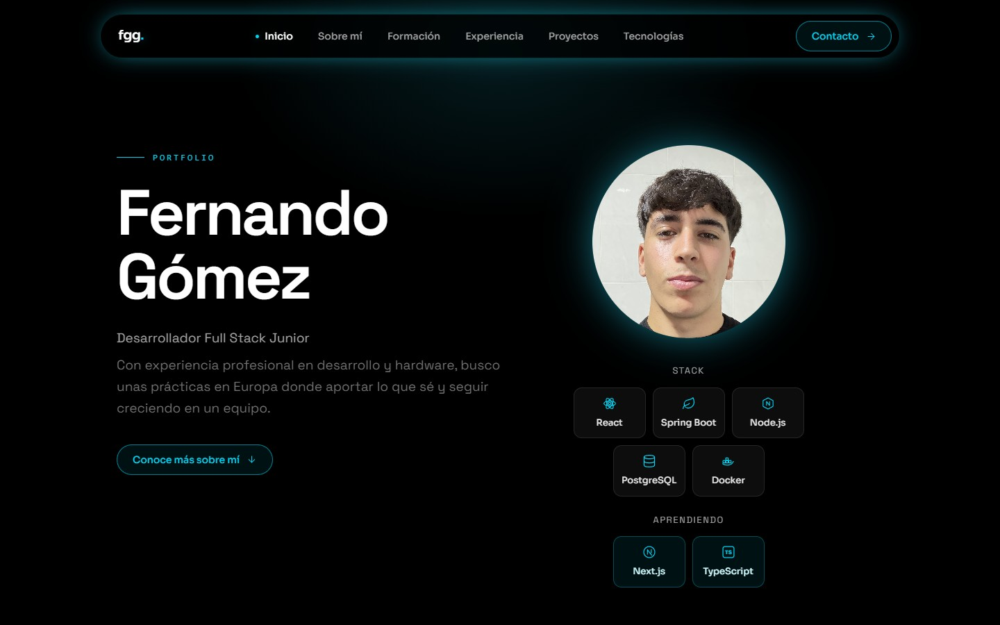

<div align="center">

# Fernando Gómez · Portfolio

Mi portfolio personal como desarrollador Full Stack Junior.<br />
*My personal portfolio as a Junior Full Stack Developer.*


**[fgomez2.dev →](https://fgomez2.dev)**



[Español](#espanol) · [English](#english)

</div>

<a id="espanol"></a>
## Español

Una web de una sola página que reúne quién soy, mi formación, mi experiencia y
mis proyectos. Cada proyecto tiene además su propia página de detalle.

<a id="caracteristicas"></a>
### Características

- Diseño oscuro con un único acento neón cian.
- Responsive mobile-first, con un menú propio para móvil.
- Página de detalle para cada proyecto.
- Accesible: se puede navegar con el teclado y respeta `prefers-reduced-motion`.
- Preparada para compartir y para buscadores: Open Graph, Twitter Cards y datos estructurados.

<a id="estructura"></a>
### Estructura

```
src/
├── components/     # Secciones de la página y piezas reutilizables
│   └── proyectos/  # Tarjetas y tecnologías de cada proyecto
├── paginas/        # Una por ruta: inicio y detalle de proyecto
├── datos/          # Contenido de los proyectos y las tecnologías
├── redes.js        # Enlaces a GitHub, LinkedIn y correo
└── index.css       # Tema de Tailwind v4: fuentes y utilidades
public/             # Favicon, imagen para redes y capturas de proyectos
```

<a id="autor"></a>
### Autor

**Fernando Gómez** · [fgomez2.dev](https://fgomez2.dev) · [GitHub](https://github.com/fgomez2) · [LinkedIn](https://www.linkedin.com/in/fernandogomgar)

---

<a id="english"></a>
## English

A single-page site that brings together who I am, my education, my experience
and my projects. Each project also has its own detail page.

<a id="features"></a>
### Features

- Dark design with a single neon cyan accent.
- Mobile-first responsive layout, with a dedicated mobile menu.
- A detail page for each project.
- Accessible: keyboard navigable and respects `prefers-reduced-motion`.
- Ready for sharing and search engines: Open Graph, Twitter Cards and structured data.

<a id="structure"></a>
### Structure

```
src/
├── components/     # Page sections and reusable pieces
│   └── proyectos/  # Project cards and their technologies
├── paginas/        # One per route: home and project detail
├── datos/          # Project and technology content
├── redes.js        # Links to GitHub, LinkedIn and email
└── index.css       # Tailwind v4 theme: fonts and utilities
public/             # Favicon, social image and project screenshots
```

<a id="author"></a>
### Author

**Fernando Gómez** · [fgomez2.dev](https://fgomez2.dev) · [GitHub](https://github.com/fgomez2) · [LinkedIn](https://www.linkedin.com/in/fernandogomgar)
